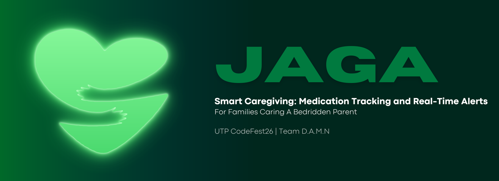

# Jaga

**A caregiver dashboard and smart button box for families looking after a bedridden parent.**
Built for UTP CodeFest'26, theme *Innovating For The People, By The People*.

**Team:** D.A.M.N

**Members:**
- Harith Irfan bin Mohd Eddiputra
- Deenira Lipin
- Ainin Nabihah binti Osman
- Humaira Kaisah binti Ahmad Sherhan

**Video:** https://drive.google.com/file/d/1wPXEytA6Zl69A-pzi9ZafKHjitqEdPR6/view?usp=sharing 

**Repository:** https://github.com/JAGA-CAREGIVER-ALERT/jaga-project-codefest

**Live demo:** https://jaga-caregiver-alert.github.io/jaga-project-codefest/dashboard/

**Hardware simulation (Wokwi):** https://wokwi.com/projects/478143271603239937

---

## 1. The problem (Impact)

Malaysia is getting older. The Department of Statistics Malaysia (DOSM) reports that in 2024 about **3.9 million people (11.6%) were aged 60 or over**, and projects Malaysia will become an **ageing nation in 2030**, when the share aged 60+ passes 15% [1]. More older people means more families caring for a parent at home, often alone.

A parent who is bedridden cannot easily call out. The caregiver has to stay close, listen for them, and remember which medicine was given when. A study of 271 family caregivers of older people in Pahang found that caregiver burden was linked to the older person's level of independence and chronic disease [2].

**Jaga helps in three ways:**

| Problem for the caregiver | What Jaga does |
|---|---|
| "I can't always hear or see my parent." | Four large buttons by the bed (toilet, eating, pain, general). One press sends an alert to the caregiver's phone, with a sound. |
| "Did Mum already take her pills today?" | A Monday to Sunday medicine tray with a light sensor in each slot. Opening a slot ticks it on the dashboard. |
| "What should I tell the doctor?" | An AI summary of the week's press patterns in **English and Bahasa Melayu**, with a one-tap copy to share. It reports patterns only and never diagnoses. |

**Why "By The People":** the design comes from the daily routine of caregivers: large tap targets, a bilingual interface, and an emergency bar (Call doctor, Call family, 999) that is always on screen.

---

## 2. Features

- **Parent buttons:** toilet, eating, pain, general. Alerts appear within seconds, with a sound and vibration.
- **Medicine tray:** 7 slots (Mon to Sun) sensed by light sensors. The dashboard shows which slots were opened.
- **Medicine page:** weekly schedule by time of day, editable medicine list and per-day schedule.
- **AI analysis:** counts and trends for pain, toilet, eating and medicine, plus a plain-language summary (patterns only, no diagnosis, suggests seeing a doctor when needed).
- **Bilingual:** English and Bahasa Melayu, switchable at any time.
- **Caregiver settings:** caregiver name and relationship, patient name, age and doctor's notes, emergency contacts, alert and sound switches.
- **Share with the doctor:** one tap copies a short summary.
- **Mobile-first:** designed for a phone, works on desktop.

---

## 3. How it works

```
 Parent buttons + tray sensors
            |
         ESP32  --Wi-Fi/HTTPS-->  Firebase Firestore  <--- live updates ---  Caregiver dashboard (phone/browser)
                                        ^                                          |
                                        |                                          | "Refresh AI summary"
                                        +----------  AI insight function  <--------+
                                                    (Node.js, optional Claude API)
```

The full architecture and tech stack diagrams are in our slide submission.

---

## 4. Prototype status (please read)

- **The hardware prototype runs in the Wokwi online simulator** (ESP32 + 4 push buttons + 7 light-sensor modules + 2 LEDs). The simulated ESP32 runs the **same firmware** (`firmware/jaga_esp32/jaga_esp32.ino`) and sends real data to the real Firebase database, which the real dashboard reads live. Pressing a simulated button creates an alert on the dashboard.
- The firmware is written for a physical ESP32 DevKit. Our own board could not be flashed (it reports a locked secure-boot setting), so a physical build is the next step, not something we are claiming.
- Sample data on the dashboard (before Firebase is connected, and the demo week of history) is **synthetic**.
- The AI summary uses a **built-in rule-based writer** by default. If a Claude API key is set, it uses the Claude model instead. Both follow the same safety rules (patterns only, no diagnosis).
- The live demo's "Refresh AI summary" button needs the AI function running on a computer, so it only works locally. Everything else works online.

---

## 5. Technology, libraries, APIs and AI disclosure

| Layer | What we used |
|---|---|
| Dashboard | HTML, CSS, vanilla JavaScript (no framework). Font: Lexend (Google Fonts). |
| Database | Google Firebase Firestore, Firebase JS SDK 10.14.1 (loaded from gstatic.com). |
| Hardware | ESP32 DevKit, Arduino core for ESP32 (`WiFi`, `WiFiClientSecure`, `HTTPClient`, `time`). Sends data with the Firestore REST API. |
| Simulator | Wokwi (wokwi.com) |
| AI function | Node.js 18+, Firestore REST API, optional Anthropic Messages API (`claude-haiku-5-5`) |
| Hosting (optional) | Vercel (free tier) for the AI function; any static host for the dashboard |
| Sounds / animation | Browser Web Audio API and CSS (no audio files, no animation library) |
| Testing | Playwright (headless browser tests, development only) |

**AI tools disclosure**
- **Claude (Anthropic)** was used as a coding and design assistant during development: it helped write and review code, diagrams and documents. All results were run and tested by the team.
- **Claude (Anthropic API)** is used at run time **only if** an API key is configured, to turn counted statistics into a short summary. It receives counts only (for example "10 pain presses this week"), never names or personal details.

**Datasets:** none. Sample data is made up by us.

---

## 6. Feasibility

### Cost (one device, approximate)

Estimated Malaysian retail prices. Replace with your own receipts before submitting.

| Part | Qty | Approx. cost (RM) |
|---|---|---|
| ESP32 DevKit board | 1 | 25 to 35 |
| Push buttons (large, arcade style) | 4 | 5 to 12 |
| LDR light-sensor modules (LM393) | 7 | 14 to 21 |
| LEDs + resistors | 2 | 1 to 2 |
| Wires, breadboard or small PCB | 1 set | 8 to 12 |
| USB cable + phone charger | 1 | 10 |
| Pill tray / enclosure | 1 | 8 to 15 |
| **Total** | | **about RM 70 to 107** |

Software cost for a pilot is RM 0: Firebase and Vercel have free tiers, and the AI summary works without a paid key. If the Claude key is used, the cost is small because each summary sends only a few counts.

### Privacy and safety

- Jaga records **button presses and tray openings only**. There is **no camera and no microphone**.
- The AI shows **patterns only**. It does not diagnose, name illnesses, or recommend medicines or doses, and it suggests a doctor visit when something changes.
- Only the data needed for the dashboard is stored. The AI receives counts, not personal details.
- We follow the spirit of Malaysia's Personal Data Protection Act 2010: collect only what is needed, tell the user what is collected, and keep it secure.
- The database uses locked-down rules (`firestore.rules`): each collection accepts only the exact fields Jaga writes, and nothing can be deleted.

### Limits we are open about

- Needs Wi-Fi at the bedside. If Wi-Fi drops, the device keeps up to 16 events in memory and sends them when it reconnects.
- One patient per device. Settings and the medicine list are saved in the caregiver's browser, not yet in the cloud.
- No user login yet. Before a real pilot we would add Firebase Authentication and App Check, so only the family can read the data.
- Medicine tracking shows that a slot was **opened**, not that the medicine was **swallowed**.

### Next steps

1. Build the physical device, with a battery and a proper enclosure.
2. Add login and push notifications.
3. Pilot with a few caregivers through an NGO or clinic and measure the response time to alerts.
4. Add offline mode and a Bahasa Melayu voice announcement for the caregiver.

---

## 7. How we match the judging criteria

| Criteria | Where to see it |
|---|---|
| **Impact (30%)** | Section 1 (problem, DOSM statistics), the bilingual interface, the caregiver-first design |
| **Technical Execution (30%)** | Hardware to cloud to AI to live dashboard chain (Section 3), firmware, Firestore rules, serverless AI function |
| **Usability (25%)** | Mobile-first layout, large buttons, sounds, English/BM toggle, always-visible emergency bar |
| **Feasibility (15%)** | Section 6: cost, privacy, limits, next steps |

---

## 8. Run it yourself

**You need:** Node.js 18+, VS Code with the Live Server extension, a free Firebase account.

### A. Firebase (database)
1. Go to the [Firebase console](https://console.firebase.google.com), create a project, and add a **Web app**.
2. Create a **Firestore Database** in **test mode** to start.
3. Copy the `firebaseConfig` values into `dashboard/firebase-config.js`.
4. When everything works, open **Firestore > Rules**, paste the contents of `firestore.rules`, and click **Publish**.
   After this, the "Delete events" button in `manual-entry.html` stops working on purpose (nothing can be deleted). To clear test data, delete it in the Firebase console.

### B. Dashboard
1. Open the `dashboard` folder in VS Code.
2. Right-click `index.html` > **Open with Live Server**.
3. To add test data without hardware, open `manual-entry.html` (it adds events and a sample week).

### C. AI summary (optional)
1. In `insight-api`, copy `.env.example` to `.env` and fill in `FIREBASE_PROJECT_ID` and `FIREBASE_API_KEY`. Add `ANTHROPIC_API_KEY` for the Claude summary (leave it out to use the built-in writer).
2. Run: `node --env-file=.env local-server.js`
3. In `dashboard/firebase-config.js` set `insightUrl: "http://localhost:3000/api/insight"`.
4. Open the Analysis page and tap **Refresh AI summary**.

### D. Hardware (Wokwi)

**Quick way (recommended):** open the Wokwi link at the top of this page, press **Play**, then click a button in the simulation. The live dashboard updates within seconds.

**Build your own copy:**
1. Create a new ESP32 project at [wokwi.com](https://wokwi.com).
2. Paste `firmware/jaga_esp32/jaga_esp32.ino` and `firmware/jaga_esp32/diagram.json`.
3. Edit the top of the sketch (Wi-Fi is already set to `Wokwi-GUEST` for the simulator). Keep `DEVICE` as `jaga-01`.
4. Press **Play**, then click a button in the simulator, or drag a light sensor's light-level slider to open a tray slot. The dashboard updates within seconds.

**Never commit** your real Wi-Fi password, `.env`, or API keys.

---

## 9. Files

```
dashboard/        web app (index.html, app.js, styles.css, i18n.js, firebase-config.js, manual-entry.html)
insight-api/      AI summary function (api/insight.js, local-server.js)
firmware/         ESP32 sketch + Wokwi diagram
firestore.rules   database security rules
DATA_CONTRACT.md  names and formats shared by hardware, database and app
```

---

## Sources

1. DOSM population figures reported in [Malay Mail, 31 July 2024](https://www.malaymail.com/news/malaysia/2024/07/31/malaysia-set-to-become-ageing-nation-by-2030-perak-leads-senior-surge-dosm-report-says/145577) (DOSM projection: Malaysia becomes an ageing nation in 2030).
2. Pairoh et al., [The Caregiving Burden of Older People with Functional Deficits and Associated Factors on Malaysian Family Caregivers](https://pmc.ncbi.nlm.nih.gov/articles/PMC10917587), Malaysian Journal of Medical Sciences, 2024; 31(1):161-171.
